# Packaging Automation System Visualization

An interactive, spatial visualization of a six-station packaging automation line. Every machine is a hand-built isometric line figure, driven by a deterministic, fully offline simulation. You pan and zoom around the line, select a machine or one of its parts, follow a single product from intake to dispatch, cause a fault and walk through its recovery.

**Live demo:** [packaging-automation.vercel.app](https://packaging-automation.vercel.app)
**Guided tour (about 2 minutes):** [packaging-automation.vercel.app/production?demo=1](https://packaging-automation.vercel.app/production?demo=1)

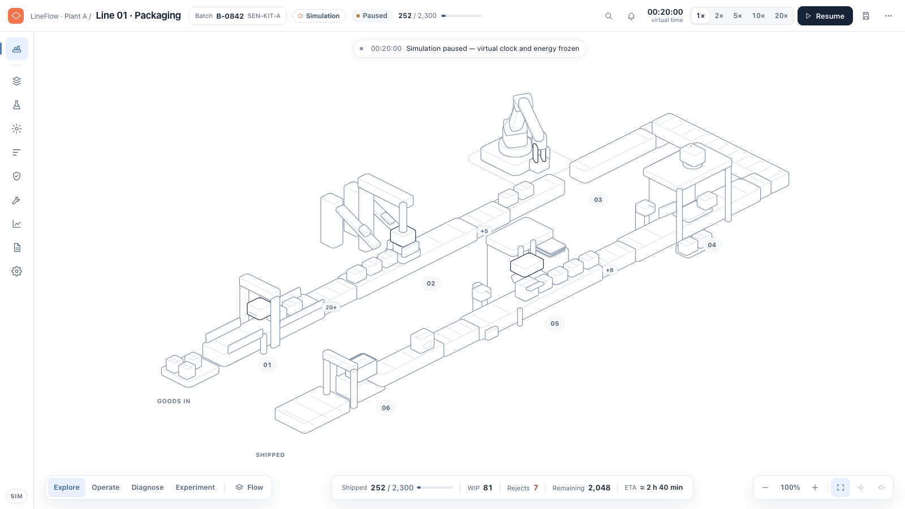

> **Simulation only.** Everything you see is generated in the browser by a seeded simulation. There is no connection to real machines, no credentials and no backend. The "Simulation" label stays visible on every screen.

---

## Contents

- [What it shows](#what-it-shows)
- [Features](#features)
- [Screenshots](#screenshots)
- [Getting started](#getting-started)
- [Using the app](#using-the-app)
- [Testing](#testing)
- [Project structure](#project-structure)
- [Architecture](#architecture)
- [Deployment](#deployment)
- [Design principles and constraints](#design-principles-and-constraints)
- [Known limitations](#known-limitations)
- [Credits](#credits)

## What it shows

Industrial workflows are usually presented as unrelated tables, so finding the cause of a problem takes effort. This project shows one packaging line as a single white-canvas workspace instead:

| Station | Role |
|---|---|
| Intake | Receives raw kits onto the line |
| Assembly | Assembles the kit on a fixture |
| Robot | Six-phase pick-and-place with inverse kinematics, bridging the two rows |
| QA | Inspects each unit and diverts rejects |
| Packaging | Builds a carton around the kit |
| Dispatch | Packs cartons into cases and cases onto pallets |

A fault, the queue it causes and its recovery all come from the same engine events, so what you see in the scene, the inspector and the event log always agrees.

## Features

- **Spatial workspace:** full-viewport canvas with a top command bar (Simulation label, run state, virtual clock, speed, play/pause, Run menu), a left tool rail, a resizable inspector dock and a bottom status rail.
- **Camera:** wheel zoom anchored at the pointer, drag or space-drag to pan, two-finger pinch, Fit, focus on a station or part, and Follow a single unit by serial number. The camera frames around every open panel.
- **Machines and parts:** blue-grey selection drawn on the real geometry, part highlighting in both the scene and the inspector preview, and level-of-detail cues as you zoom.
- **Inspector:** Overview (including a fault card with guarded recovery steps), Parts, Activity and Config tabs. One selection is shared by the scene, Assets and Events.
- **Modes:** Explore, Operate, Diagnose and Experiment change what the workspace emphasises.
- **Data layers:** flow, capacity, health, quality and energy (energy is labelled as simulated).
- **Experiments:** compare the current run against a no-fault baseline at the same virtual time.
- **Run control:** Reset view, Restore scenario and Restart run are separate actions, and you're asked to confirm before any run with progress is replaced. Restore scenario is one click away in the bottom mode bar.
- **Tools:** batches, scenario lab, analytics, assets, events, maintenance, quality, reports and settings, all as docked drawers.
- **Persistence and export:** IndexedDB snapshots and JSON/CSV exports.
- **Guided demo:** a five-scene tour on a fixed seed (`?demo=1`) plus a presentation mode (`P` or `?present=1`). First-time visitors are offered the tour after 10 seconds of exploring; the offer is shown once and remembered.
- **Accessibility:** WCAG AA text contrast (covered by a test), a keyboard Machines navigator, visible focus, focus return, dialog focus traps, 40 px pointer targets, reduced-motion support and touch pan/pinch/tap.
- **Responsive:** overlay inspector at 1024 px and bottom sheets at 768 px. See [On phones](#on-phones) for the phone layout.

## Screenshots

| Machine selected | Part inspection |
|---|---|
| 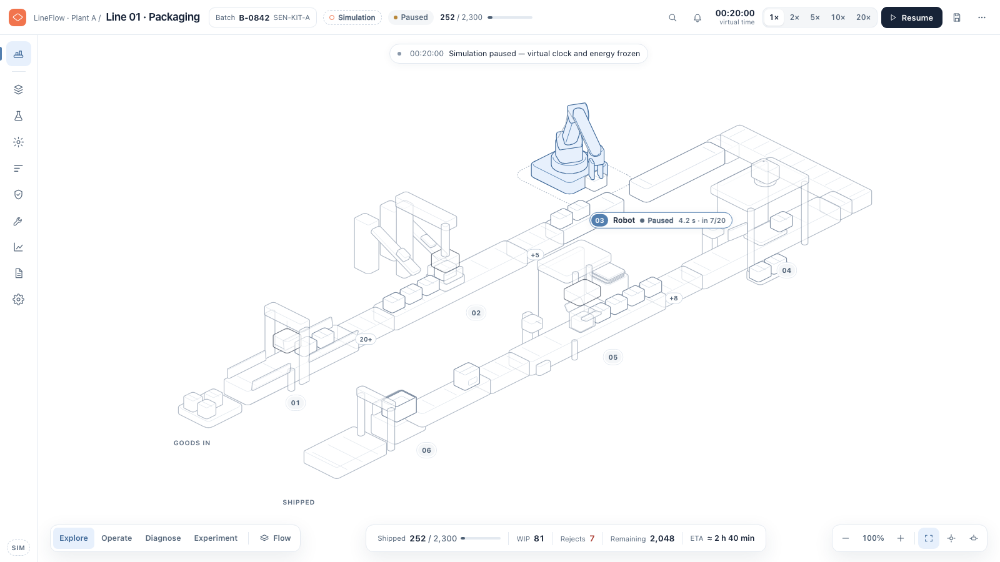 | 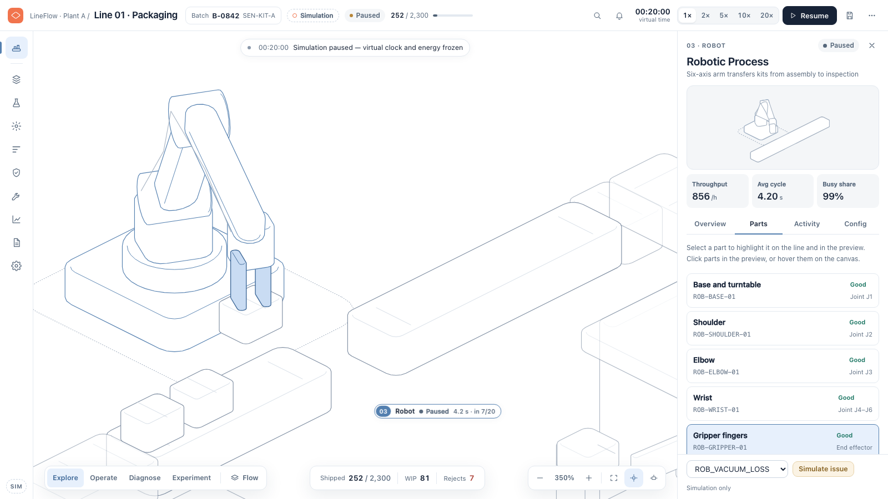 |

| Fault on the line | Experiment against a baseline |
|---|---|
| 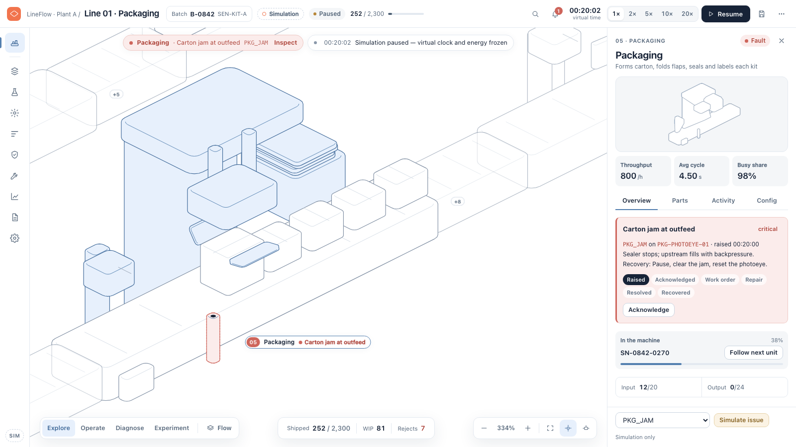 | 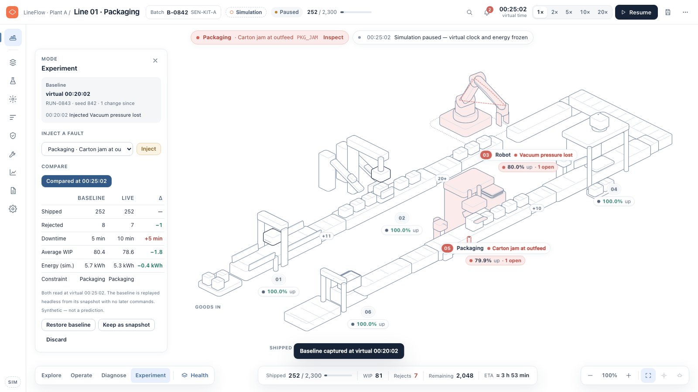 |

| Guided tour | Presentation mode |
|---|---|
| 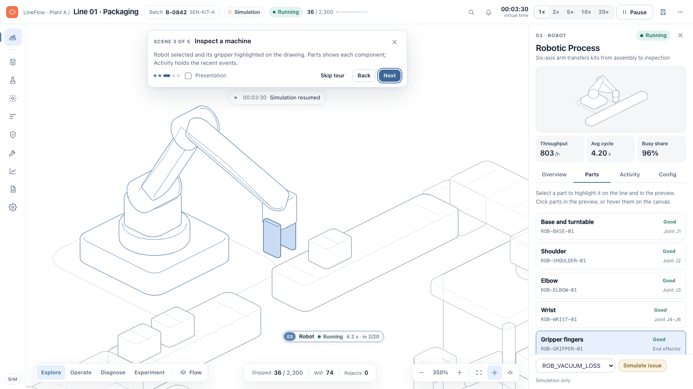 | 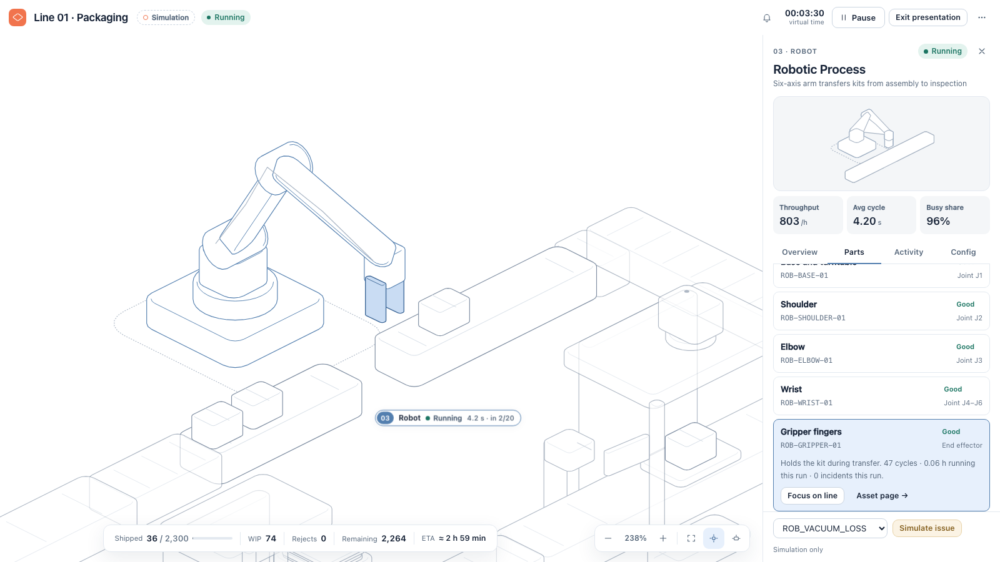 |

### On phones

| Line | Machines | Inspector | Creator | More |
|---|---|---|---|---|
| 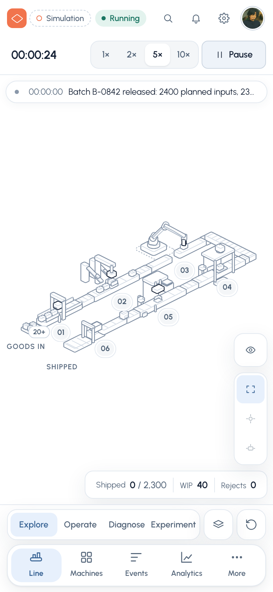 | 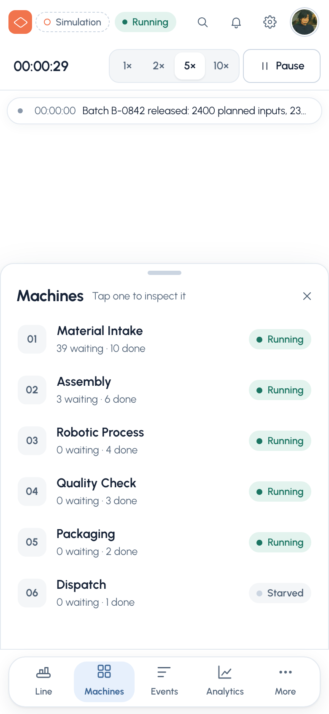 | 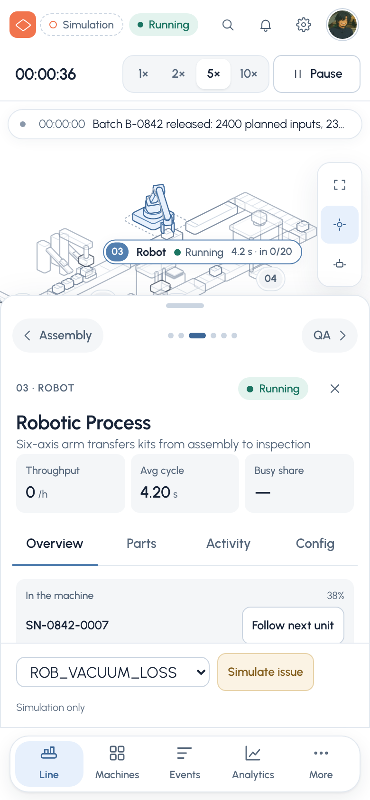 | 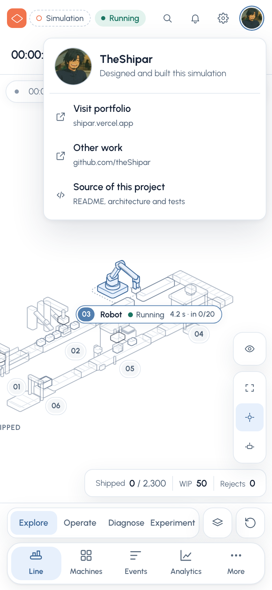 | 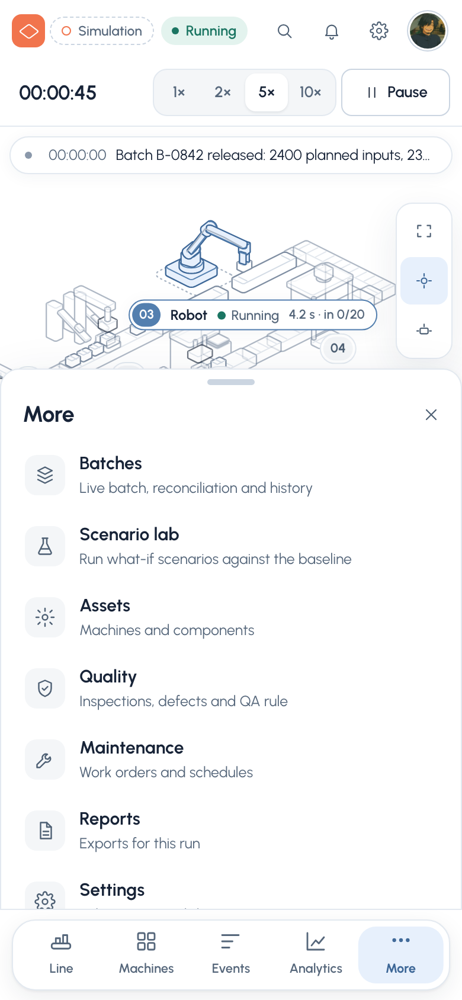 |

At 600 px and below the app switches to a phone layout:

- **Floating two-tier dock.** The top tier holds the four modes as one segmented control, plus the data layer and Restore scenario. The bottom tier holds the sections (Line, Machines, Events, Analytics, More) with a sliding indicator. The mode tier folds away while a sheet is open.
- **Machines** lists all six stations with their live status, so you can open one without aiming at a small figure.
- **Sheets.** The inspector, tool drawers and mode panels are bottom sheets: drag the handle up for full height, down to shrink or close, or tap it to toggle. The inspector has previous and next machine buttons, and you can swipe sideways on that row. Tool details have a back chevron in the header.
- **Canvas controls.** Fit, Focus and Follow stack vertically on the right edge. A separate eye button above them hides or shows the scene labels (queue counts, layer readouts and flow marks) when the map gets busy. The batch status sits right-aligned beneath them. Pinch to zoom.
- **Top bar.** It has two rows. The first holds status, search, alerts, a settings gear (the run menu) and the creator avatar, which opens links to the portfolio, other work and this repository. The second holds the clock, the 1×, 2×, 5× and 10× speeds, and a large Start / Pause button.
- Form fields are 16 px so iOS doesn't zoom the page, the layout respects the iPhone safe areas, and desktop-only items (keyboard shortcuts, presentation mode) are hidden.

A recording of the guided tour is in [`screenshots/v2/after/video/guided-tour-1600x900.webm`](screenshots/v2/after/video/guided-tour-1600x900.webm).

## Getting started

**Requirements:** Node.js 18 or newer (developed on Node 22) and npm.

```bash
git clone https://github.com/theShipar/packaging-automation-system-visualization.git
cd packaging-automation-system-visualization
npm install
npm run dev
```

Then open [http://127.0.0.1:5180/production](http://127.0.0.1:5180/production).

### Scripts

| Command | What it does |
|---|---|
| `npm run dev` | Starts the Vite dev server on port 5180 |
| `npm run build` | Type-checks and builds the production bundle into `dist/` |
| `npm run preview` | Serves the production build on port 5180 |
| `npm run typecheck` | Runs the TypeScript compiler without emitting |
| `npm test` | Runs the unit and domain tests with Vitest |

## Using the app

### URLs

| URL | Opens |
|---|---|
| `/production` | The main workspace |
| `/production?demo=1` | The guided five-scene tour |
| `/production?demo=1&present=1` | The tour in presentation mode |
| `/production?tourprompt=<ms>` | Shows the guided demo offer after `<ms>` milliseconds, even if it was dismissed before (for testing) |
| `/assets`, `/events`, `/simulation`, `/analytics`, `/maintenance`, `/quality`, `/reports`, `/settings`, `/production/batches` | The workspace with that tool drawer open |

### Keyboard shortcuts

Press `?` in the app to see this list.

| Keys | Action |
|---|---|
| Drag | Pan the canvas |
| Space + drag | Pan, even when starting on a machine |
| Wheel or pinch | Zoom at the pointer |
| `F` or `⌘0` | Fit the whole line |
| `+` / `−` | Zoom in or out around the centre |
| Double-click | Focus a machine or part |
| `[` / `]` | Previous or next machine |
| `Tab` to the Machines list | Keyboard list of machines: `↑` `↓` to move, `Enter` to inspect |
| `/` or `⌘K` / `Ctrl K` | Find and follow a serial number |
| `Esc` | Step back: popover, part, machine, follow, drawer |
| `P` | Toggle presentation mode |

### The guided tour

`/production?demo=1` runs five scenes on seed 842, each rebuilt deterministically so you can jump back and forth:

1. Overview of the whole line.
2. Follow one kit through the stations.
3. Inspect the robot's gripper.
4. Cause a packaging jam and watch the queue build.
5. Recover through the guided steps, then compare against a no-jam baseline.

## Testing

```bash
npm test                 # 62 unit and domain tests (Vitest)
npx tsc --noEmit         # type check
npx playwright install chrome   # once, for the end-to-end suite
npx playwright test smoke camera scene inspector operation a11y closeup demo qa
```

- **Unit and domain tests** (`tests/`): conservation of units, unique identities, capacities, zero-snap robot hand-off, reject routing, carton and case association, pause and speed determinism, a golden 15-minute baseline run, experiment replay, camera math, layout and colour contrast.
- **End-to-end tests** (`e2e/`): camera, scene, inspector, operation modes, accessibility, close-ups, the guided demo, the QA matrix and the phone layout (`mobile.e2e.ts`: tab bar, sheets and dragging, touch targets, landscape). Playwright starts its own server on port 5181.
- **Gated runs** (skipped by default):
  - `SHOTS=<dir>` captures screenshots.
  - `VIDEO=<dir>` records the guided tour.
  - `SOAK=1 SOAK_MIN=10 SOAK_OUT=<file>` runs a long soak test.
  - `PERF=1 PERF_OUT=<file>` records frame timings; open the app with `?perf` to enable performance marks.

## Project structure

```text
src/
  domain/      Deterministic simulation engine: stations, transfers, faults, KPIs, seeded RNG
  transport/   Product poses, belt lanes, queue layout and robot choreography
  vector/      Isometric scene, machine figures, product layer and scene overlay
  camera/      Pure camera math, controller (fit, focus, follow) and pointer/wheel/pinch input
  workspace/   App shell, command bar, rail, inspector dock, drawers, dialogs, mode bar
  features/    Inspector content and live insights
  pages/       Tool drawers: batches, scenarios, analytics, assets, events, maintenance, quality, reports, settings
  demo/        Guided tour and presentation mode
  app/         Store, experiments, persistence, exports and perf marks
  ui/          Shared UI primitives, icons and charts
  styles/      Design tokens
tests/         Vitest unit and domain tests
e2e/           Playwright end-to-end tests
reference/     Hairline reference figures each machine was drawn from
screenshots/   Before/after screenshots and the tour recording
notes/         Phase reports, QA matrix results and measurements
docs/          Additional documentation
```

## Architecture

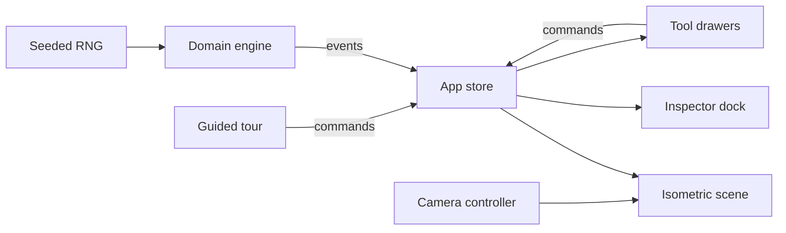

- **One source of truth.** The domain engine in `src/domain/` is pure TypeScript with a seeded RNG. The UI only sends commands and reads views; reading never changes the run.
- **One owner per product.** Each unit is a single SVG node keyed by its id, posed by `src/transport/poses.ts`, so hand-offs between stations never unmount or snap.
- **One owner of the camera.** Fit, focus, follow and user input all go through the camera controller, which frames inside a measured safe rectangle around the open panels.

More detail is in [`docs/ARCHITECTURE.md`](docs/ARCHITECTURE.md).

## Deployment

The app is a static single-page app deployed on Vercel. [`vercel.json`](vercel.json) sets the build command and output folder, and rewrites every path to `index.html` so deep links like `/assets` work on refresh. Step-by-step instructions are in [`docs/DEPLOYMENT.md`](docs/DEPLOYMENT.md).

## Design principles and constraints

- White canvas, blue-grey selection and orange only for the brand mark and alerts.
- Set in [Urbanist](https://fonts.google.com/specimen/Urbanist) (SIL Open Font License), self-hosted through Fontsource so the demo needs no font CDN.
- Offline and simulated only: no real machine control, no network calls and no credentials.
- Imported scenarios are validated with Zod and never executed.
- No WebGL or Three.js: the scene is plain SVG.
- No `Math.random` at render time: everything comes from the seeded engine, so runs are reproducible.
- No invented KPIs: every number is derived from engine events.

## Known limitations

- Station tags clip at the canvas edge when you zoom in very close.
- At 1280×800 the scene 5 comparison table needs a short scroll.
- On phones the 20× speed is hidden from the toolbar, and wide tables (such as Events) scroll sideways.
- Presentation mode doesn't use the Fullscreen API.
- Performance has only been measured headless (about 60 fps, frame p95 ≤ 16.8 ms on an Apple M4 Pro); there's no real-device GPU profile yet.
- The event log is append-only, so memory grows slowly over very long sessions.

## Credits

- Machine figures are drawn in the style of, and on the engine of, [Hairline](https://github.com/lucasmarkes/hairline) by Lucas Markes (MIT).
- Built with [React](https://react.dev), [Vite](https://vitejs.dev), [TypeScript](https://www.typescriptlang.org), [React Router](https://reactrouter.com), [Zod](https://zod.dev), [Vitest](https://vitest.dev) and [Playwright](https://playwright.dev).
- Designed and built by TheShipar ([portfolio](https://shipar.vercel.app/), [@theShipar](https://github.com/theShipar)). The avatar at the foot of the left rail links to the portfolio.
