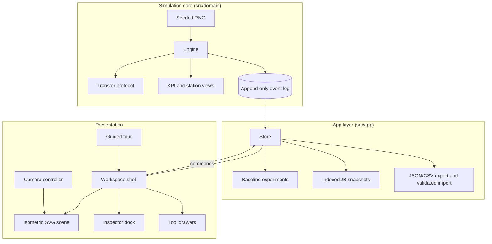

# Architecture

The app is split into a pure simulation core and a React presentation layer that only reads views and sends commands.

## Simulation core: `src/domain`

- **`engine.ts`** advances the line in virtual time. All randomness comes from `rng.ts`, seeded per run, so the same seed and the same commands always produce the same run.
- **`transfer.ts`** moves units between stations in three steps: reserve, start and complete. Each transfer has an id (`TR-000001`), emits events, completes idempotently and respects maintenance locks.
- **`kpis.ts`** derives station views and KPIs from engine state. Arrived units and in-flight (reserved) units are kept separate.
- **`invariants.ts`** checks conservation and identity rules, which the tests run against long simulations.
- **`scenarios.ts`** and **`config.ts`** define the presets used by the scenario lab.

The domain has no React or DOM imports.

## Transport: `src/transport`

- **`layout.ts`** places the six stations in a compact two-row cell under one shared isometric camera, with a U-turn bridge from the robot to QA.
- **`poses.ts`** turns engine state into a world position for every unit at the current virtual time. Units move along belt lanes at belt speed.
- **`queueLayout.ts`** lays out visible queue slots and an overflow `+N` badge.
- **`robotChoreography.ts`** drives the robot through its pick-and-place phases, using inverse kinematics to reach exact pickup and placement points so the kit never snaps.

## Scene: `src/vector`

- **`figures.ts`** and **`builder.ts`** draw each machine as an isometric line figure in the Hairline style; `iso.ts` holds the projection.
- **`Scene.tsx`** renders the machines, lanes, hit areas, selection and part highlights inside one world `<g>` transformed by the camera.
- **`ProductLayer.tsx`** renders every unit, carton and case as a single node keyed by id.
- **`SceneOverlay.tsx`** projects labels, tags and tooltips into screen space and keeps them inside the visible area.

## Camera: `src/camera`

- **`camera.ts`** is pure math (fit, focus, zoom around a point, clamp) and is unit-tested.
- **`controller.ts`** animates between camera targets and owns Follow mode.
- **`useCameraInput.ts`** maps pointer, wheel, pinch and keyboard input to camera commands.

The workspace measures a "safe rectangle" that excludes the inspector, drawers, bottom sheets and the tour card, so Fit and Focus always frame the line in the space you can actually see.

## Workspace: `src/workspace`

`AppShell` composes the top command bar, the left rail, the canvas region, the inspector dock, the tool drawer, the mode bar and the status rail. `workspaceStore.ts` holds UI-only state (selection, mode, layer, open drawer), which is separate from the simulation store.

## Guided tour: `src/demo`

`demo.ts` defines five scenes on seed 842. Entering a scene rebuilds it from scratch (reset to the seed, then fast-forward), so scenes can be visited in any order and always look the same. `TourCard.tsx` is the on-screen card, and presentation mode hides non-essential chrome.

## Quality gates

- `npm test`: 62 Vitest tests covering the engine, transport, geometry, layout, camera math, the golden baseline, experiments and colour contrast.
- Playwright end-to-end suites in `e2e/`, including accessibility checks and a 10-minute soak test.
- Phase reports, the QA matrix and performance measurements are in [`notes/`](../notes).
